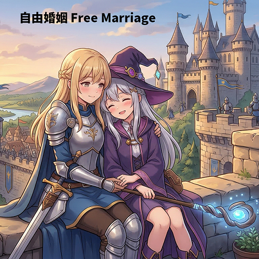

# Free Marriage / 自由婚姻

> 让二次元角色也能百合的 CK3 同性婚姻 mod。
>
> A Crusader Kings III mod that enables same-sex marriage without the vanilla game rule, so achievements stay available.

- **Steam Workshop:** <https://steamcommunity.com/sharedfiles/filedetails/?id=3688093487>
- **Supported game version:** 1.20.*

---

## 中文

### 为什么会有这个 mod

创建这个 mod 的动机很简单：想让二次元角色能百合。（什么？你想要男同？……我尊重你的选择……）

但直接打开原版的「同性婚姻」游戏规则有两个问题：

1. 原版规则 `accepted_same_sex_marriage` 带有 `blocks_achievements` 标记，开启后本局无法获得成就。
2. 原版 AI 判断是否离婚时只看「有没有自己的继承人」和「配偶生育力」，不会区分同性还是异性伴侣。于是同性伴侣可能因为「配偶生育力低」这种对同性婚姻毫无意义的理由被 AI 离婚。

所以这个 mod 绕开了原版规则，用自己的游戏规则实现同性婚姻，并让 AI 不再拿生育力当理由拆散同性伴侣。

### 功能

- **同性婚姻、订婚与纳妾**：同性角色可以正常求婚、订婚、结婚；在允许纳妾的政体/宗教下也可以纳同性妾室。安排婚姻界面会照常列出同性候选人。
- **两个自定义游戏规则**：可以分别设置允许哪种同性配对，以及是否保留宗教限制（见下表）。
- **成就可用**：不依赖原版 `same_sex_marriage` 规则。本 mod 新增的规则没有 `blocks_achievements` 标记，因此不会像原版那条规则一样禁用成就。
- **不再因生育力被离婚**：在 AI 发起的离婚判定中（主动离婚、请求家主/宗教领袖批准离婚、宗族领袖强制离婚等），同性伴侣会跳过「无继承人 + 配偶生育力低」这条理由；异性婚姻保持原版行为不变。
- **宗教限制可选**：默认完全忽略教义；也可以要求只有不将同性恋视为 `shunned` / `illegal` 的信仰才能进行同性婚姻。

### 游戏规则

| 规则 | 选项 | 默认 | 效果 |
| --- | --- | :---: | --- |
| 自由婚姻：同性婚姻 | 都允许 | ✅ | 女女与男男婚姻都可以 |
| | 仅百合 | | 只允许女女婚姻 |
| | 仅男同性恋 | | 只允许男男婚姻 |
| 自由婚姻：宗教限制 | 无宗教限制 | ✅ | 忽略宗教教义，所有角色都可以同性结婚 |
| | 宗教限制 | | 只有信仰/仪式不反对同性恋时才能同性结婚 |

> 这两条规则属于「游戏模式」分类，需要在**开局前的规则界面**设置。

### 使用建议

- 把原版「同性婚姻」规则保持默认（关闭），改用本 mod 的规则。开启原版那条规则既没必要，又会禁用成就。
- 想玩百合就把「自由婚姻：同性婚姻」设为「仅百合」；默认的「都允许」则是两种都开放。
- 如果打开「宗教限制」，只有信仰的教义没有把同性恋标为 `shunned` 或 `illegal` 时，同性婚姻才会被允许。

### 兼容性与注意事项

- 覆盖了原版的 `common/scripted_triggers/00_marriage_triggers.txt` 和 `common/character_interactions/00_marriage_interactions.txt`，因此与其他修改婚姻/离婚逻辑的 mod 可能冲突。其中 `00_marriage_interactions.txt` 是原版 1.20 文件的完整副本，只改了与「生育力离婚」相关的五处判断。
- 不改变怀孕与生育机制：同性伴侣仍然无法自然生育后代。本 mod 只是不让 AI 因此提出离婚。
- 同性婚姻同样受其他普通婚姻条件限制（近亲、年龄、婚姻状况、教职人员等）。

### 安装

- **创意工坊**：订阅后于启动器启用即可。
- **手动安装**：将本文件夹放入 `Crusader Kings III/mod/`，在启动器中启用。

### 文件结构

| 文件 | 作用 |
| --- | --- |
| `common/game_rules/00_free_marriage_rules.txt` | 定义两个自定义游戏规则 |
| `common/scripted_triggers/00_marriage_triggers.txt` | 把同性婚姻判定改为使用本 mod 的规则 |
| `common/character_interactions/00_marriage_interactions.txt` | 跳过同性伴侣的「生育力低」离婚理由 |
| `localization/english/`、`localization/simp_chinese/` | 英文与简体中文本地化 |

---

## English

### Why this mod exists

This mod was created to let anime-style characters have yuri relationships. (What? You want gay men too? ... I respect your choice.) It also avoids two problems with the vanilla setup:

1. The vanilla `accepted_same_sex_marriage` game rule has the `blocks_achievements` flag, so turning it on disables achievements for that campaign.
2. The vanilla divorce AI only checks "do I have an heir of my own" and "is my spouse's fertility low", without distinguishing same-sex from opposite-sex couples. A same-sex couple could therefore be divorced for "low fertility" — a reason that makes no sense for them.

Free Marriage bypasses the vanilla rule with its own game rules, and stops the AI from using fertility as a reason to divorce a same-sex spouse.

### Features

- **Same-sex marriage, betrothal and concubinage**: same-sex characters can court, betroth and marry normally, and can take same-sex concubines where concubinage is allowed. The arrange-marriage list includes same-sex candidates.
- **Two custom game rules**: choose which same-sex pairings are allowed and whether religious restrictions apply (see the table below).
- **Achievements stay enabled**: the mod does not use the vanilla `same_sex_marriage` rule. Its custom rules have no `blocks_achievements` flag, so they do not disable achievements the way the vanilla rule does.
- **No more fertility divorces**: in AI-initiated divorce checks (self divorce, house-head / religious-head approval requests, dynast-forced divorces), same-sex couples skip the "no heir + low-fertility spouse" reason. Opposite-sex marriages keep vanilla behavior.
- **Optional religious restriction**: by default faith doctrine is ignored; alternatively, only faiths/rites that do not treat homosexuality as `shunned` or `illegal` may perform same-sex marriages.

### Game rules

| Rule | Option | Default | Effect |
| --- | --- | :---: | --- |
| Free Marriage: Same-Sex Type | Both Allowed | ✅ | Both female-female and male-male marriages |
| | Yuri Only (F/F) | | Female-female marriages only |
| | Gay Only (M/M) | | Male-male marriages only |
| Free Marriage: Religion | No Religion Restriction | ✅ | Ignore faith doctrine entirely |
| | Religion Restriction | | Only faiths/rites that permit homosexuality allow same-sex marriage |

> These rules are in the "game modes" category and must be set in the **pre-game rules screen**.

### Notes

- Leave the vanilla "Same-Sex Marriage" rule at its default (off) and use this mod's rules instead. Turning the vanilla rule on is unnecessary here and disables achievements.
- The mod overrides `common/scripted_triggers/00_marriage_triggers.txt` and `common/character_interactions/00_marriage_interactions.txt`, so it may conflict with other mods that change marriage or divorce logic. The interactions file is a full copy of the vanilla 1.20 file with only the five fertility-divorce checks changed.
- Pregnancy and reproduction are unchanged: same-sex couples still cannot conceive naturally. The mod only removes fertility as an AI divorce reason.
- Same-sex marriages are still subject to normal marriage requirements (consanguinity, age, marital status, clergy restrictions, etc.).

### Installation

- **Steam Workshop**: subscribe and enable the mod in the launcher.
- **Manual**: place this folder in `Crusader Kings III/mod/` and enable it in the launcher.

### Files

| File | Purpose |
| --- | --- |
| `common/game_rules/00_free_marriage_rules.txt` | Defines the two custom game rules |
| `common/scripted_triggers/00_marriage_triggers.txt` | Routes same-sex marriage checks through the mod's rules |
| `common/character_interactions/00_marriage_interactions.txt` | Skips the low-fertility divorce reason for same-sex couples |
| `localization/english/`, `localization/simp_chinese/` | English and Simplified Chinese localization |
